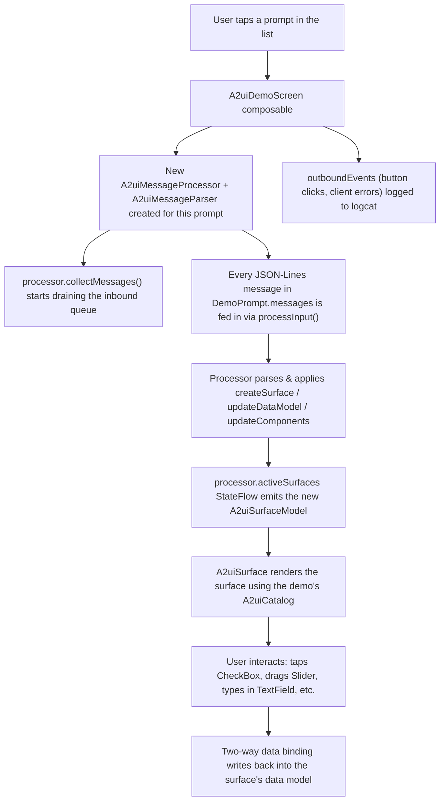

# A2UI Library Demo

An Android tutorial app that demonstrates the capabilities of **[A2UI Compose](https://developer.android.com/jetpack/androidx/releases/a2ui-compose)** — a Jetpack library that lets a client render a live, interactive Compose UI from a stream of server-sent JSON messages (the *A2UI protocol*), as commonly used to render UI driven by an AI agent.

The app opens on a **Home** screen with two modes:

- **Catalog Demo** — the original tutorial: a selectable list of "prompts," each a small, hand-written script of A2UI protocol messages fed into a live `A2uiMessageProcessor`. It's a hands-on catalog of every component in the spec.
- **AI Prompt Demo** — a real agent-to-UI round trip: type a free-text request (e.g. "a sign-up form with a name field and a submit button"), and the **Gemini API** writes the A2UI JSON-Lines script itself, which is rendered live using the exact same renderer as the Catalog Demo. A **Settings** screen (gear icon on Home) lets you paste in your own Gemini API key.

## What is A2UI?

A2UI ("Agent-to-UI") is a protocol + Compose runtime that lets a server (typically an AI agent) describe a UI declaratively as a stream of JSON-Lines messages, and have a client render and interact with that UI live, without shipping any client-specific UI code. The client:

1. Receives a `createSurface` message — allocates a new UI "surface" bound to a **catalog** (a registry of component renderers, identified by a catalog URL).
2. Receives one or more `updateComponents` messages — declares/updates the component tree for that surface (a graph of typed components like `Text`, `Row`, `CheckBox`, etc., each referencing children by id).
3. Optionally receives `updateDataModel` messages — seeds/updates values in the surface's data model, which two-way-bound component properties (like a `CheckBox`'s `value`) read from and write to.
4. Emits events back (e.g. button clicks, error messages) via an outbound event stream — this is how a real client would tell the agent server what the user did.

This app plays the role of both "server" (the hardcoded demo scripts) and "client" (the actual A2UI Compose rendering) so you can see the whole protocol round-trip in one place.

## How the app works



### App structure

```
app/src/main/java/com/example/a2uilibrarydemo/
├── MainActivity.kt              Entry point + root composable (prompt picker <-> demo screen)
├── ui/theme/                    Standard Compose Material3 theme (Color/Theme/Type)
├── a2ui/
│   ├── A2uiDemoPrompts.kt       The 17 tutorial "prompts": raw A2UI JSON-Lines scripts + metadata
│   ├── A2uiDemoScreen.kt        A2uiDemoScreen (per DemoPrompt) + A2uiMessagesRenderer (reusable core:
│   │                            processor/parser + A2uiSurface, shared with the AI Prompt screen)
│   └── A2uiDemoCatalog.kt       Builds the A2uiCatalog: supplies Image/Video/AudioPlayer/UrlOpener/
│                                MessageFormatter implementations the Basic Catalog V1 needs
└── ai/
    ├── GeminiClient.kt         Calls the Gemini `generateContent` REST endpoint with a system
    │                           prompt teaching the model the A2UI protocol contract; returns the
    │                           response split into A2UI JSON-Lines messages
    ├── GeminiApiKeyStore.kt    Persists the user's Gemini API key in local SharedPreferences
    ├── AiPromptScreen.kt       Free-text prompt field + "Generate UI" button; renders the result
    │                           via A2uiMessagesRenderer
    └── GeminiSettingsScreen.kt Lets the user paste in / save their Gemini API key
```

| File | Responsibility |
|---|---|
| `MainActivity.kt` | Hosts a `Scaffold` with a `TopAppBar` and a `HomeScreen` with two entry points, `TopScreen.CATALOG` and `TopScreen.AI_PROMPT`, plus a `TopScreen.SETTINGS` destination. Selection state survives process death via `rememberSaveable`. |
| `A2uiDemoPrompts.kt` | Defines the `DemoPrompt` data class and the full list of demo prompts, each expressed as a list of raw A2UI protocol JSON strings. Includes helper functions (`header()`, `updateComponents()`, `updateDataModel()`) for building protocol-correct message envelopes. |
| `A2uiDemoScreen.kt` | `A2uiMessagesRenderer(messages, key, ...)` is the reusable core: creates a fresh `A2uiMessageProcessor`/`A2uiMessageParser` pair keyed on `key`, starts `collectMessages()`, feeds every line of `messages` through `processInput()`, logs any outbound `A2uiClientErrorMessage`s, and renders the resulting surface with `A2uiSurface`. `A2uiDemoScreen(prompt)` is a thin wrapper over it for the Catalog Demo; `AiPromptScreen` calls it directly with Gemini-generated messages. |
| `A2uiDemoCatalog.kt` | Builds the single `A2uiCatalog` (via `materialA2uiBasicCatalogV1(...)`) shared by every demo, providing the five component slots that have no built-in Material default: `Image`, `Video`, `AudioPlayer`, `UrlOpener`, `MessageFormatter`. |
| `GeminiClient.kt` | Plain `HttpURLConnection` + `org.json` call to `POST /v1beta/models/{model}:generateContent` (no SDK dependency). The system instruction restates the exact protocol rules from `A2uiDemoPrompts.kt` (version-as-sibling, `root` id, absolute `updateDataModel` paths, data-binding for interactive values) plus the full Basic Catalog V1 component/property reference, so Gemini's freeform response is a directly-consumable JSON-Lines script. |
| `GeminiApiKeyStore.kt` | Reads/writes the API key from a private `SharedPreferences` file. |
| `AiPromptScreen.kt` | Free-text prompt input (with tap-to-fill suggestions), calls `generateA2uiScript()` on a coroutine, and renders the result via `A2uiMessagesRenderer`. |
| `GeminiSettingsScreen.kt` | Simple API key entry field (with a show/hide toggle) that saves to `GeminiApiKeyStore`. |

## The A2UI protocol, as used by this app

Every message is a single-line JSON object (JSON-Lines) with a `version` field as a **sibling** of the message-type key — `version` is validated per-message, not once for the whole stream:

```json
{"version":"v0.9","createSurface":{"surfaceId":"demo-surface","catalogId":"https://a2ui.org/specification/v0_9/catalogs/basic/catalog.json"}}
{"version":"v0.9","updateDataModel":{"surfaceId":"demo-surface","path":"/cb-1","value":false}}
{"version":"v0.9","updateComponents":{"surfaceId":"demo-surface","components":[
  {"id":"root","component":"Column","children":["cb-1"]},
  {"id":"cb-1","component":"CheckBox","label":"Unchecked option","value":{"path":"cb-1"}}
]}}
```

Key rules this demo app had to get right (see `A2uiDemoPrompts.kt` doc comments for the full story):

- The **first** `updateComponents` message must define a component with id `"root"` — the renderer always looks for that id as the entry point of a surface.
- **Two-way data binding**: any component property that should be user-writable (`CheckBox.value`, `TextField.value`, `Slider.value`, `ChoicePicker.value`, `DateTimeInput.value`) must be a binding reference `{"path":"<id>"}`, **not** a plain literal. A plain literal only flows through the read-only path — the widget renders but its change callback is `null`, so it looks normal but is **silently disabled**.
- **`updateDataModel.path` must be absolute** (leading `/`), e.g. `/cb-1` — unlike a component's own `{"path":"cb-1"}` reference, which is relative to the data model root and works fine without the slash.
- Send `updateDataModel` messages **before** the `updateComponents` message that binds to them, so the initial value is already seeded when the component first renders.

## Demo catalog: what's covered

The prompt list is grouped into four categories, covering every A2UI Basic Catalog V1 component:

**Content**
- `Text` — every style variant (`h1`–`h5`, `caption`, `body`)
- `Image` — `icon`, `avatar`, `mediumFeature` variants with `fit` options
- `Icon` — catalog built-in icon set, referenced by name

**Media**
- `Video` — streamed playback via Media3 ExoPlayer (`AndroidView` + `PlayerView`)
- `AudioPlayer` — streamed playback via Media3 ExoPlayer with a play/pause control

**Layout**
- `Row & Column` — flex-style arrangement and alignment
- `List` — vertical `List` of items (renders via `LazyColumn` internally)
- `Card`, `Tabs`, `Modal`, `Divider`

**Input** *(all fully interactive via data-model binding)*
- `Button` — click events (via `"action":{"event":{"name":...}}`, not data-binding)
- `TextField` — `shortText`, `longText`, `number`, `obscured` variants
- `CheckBox` — two-way bound boolean toggle
- `ChoicePicker` — single-choice (checkbox-style dropdown) and multi-choice (chips) variants
- `Slider` — draggable numeric value
- `DateTimeInput` — native Material date/time picker dialogs

## Notable implementation details

- **Image** (`A2uiDemoCatalog.kt`): loaded with plain `BitmapFactory.decodeStream` on `Dispatchers.IO` — no third-party image-loading library.
- **Video / AudioPlayer**: implemented with [Media3 ExoPlayer](https://developer.android.com/media/media3/exoplayer) (`androidx.media3:media3-exoplayer` + `media3-ui` + `media3-session`). Each demo builds its own `ExoPlayer` instance (`remember(url) { ... }`), releasing it via `DisposableEffect` when the composable leaves.
- **No `Modifier.verticalScroll()`** wraps `A2uiSurface` — some catalog components (e.g. `List`) render their own `LazyColumn` internally, and nesting a `LazyColumn` inside a `verticalScroll()` container throws at runtime. Each rendered component manages its own scrolling.
- **Error visibility**: `A2uiMessageProcessor` swallows protocol/validation exceptions internally and re-emits them as `A2uiClientErrorMessage` on its `outboundEvents` flow rather than throwing — `A2uiMessagesRenderer` collects that flow and logs errors under tag `A2uiDemoScreen`, which is essential for debugging since these errors never crash the app or show a visible toast:
  ```
  adb logcat -s A2uiDemoScreen:*
  ```
- **AI Prompt Demo / Gemini integration** (`ai/GeminiClient.kt`): calls the Gemini API's `generateContent` REST endpoint directly (`HttpURLConnection` + `org.json`, no SDK dependency) with a system instruction that restates this app's own hard-won protocol rules (version-as-sibling, `root` id, absolute `updateDataModel` paths, data-binding for interactive values) plus a reference of every Basic Catalog V1 component and its properties. The model's freeform text response is split into non-blank lines and fed straight into the same `A2uiMessagesRenderer` the Catalog Demo uses — no translation layer needed, since the model is instructed to emit valid A2UI JSON-Lines directly.

## Requirements

- Android Studio with AGP 9.4.1 / Gradle (via the included wrapper)
- Kotlin 2.2.10, Jetpack Compose BOM 2026.02.01
- minSdk 24, targetSdk 37, compileSdk 37.1
- An internet connection (demo content streams images/video/audio from public URLs; AI Prompt Demo calls the Gemini API)
- A [Gemini API key](https://aistudio.google.com/apikey) (free) to use the **AI Prompt Demo** — not required for the Catalog Demo. Paste it into the in-app Settings screen (gear icon on the Home screen).

## Building & running

```bash
./gradlew :app:assembleDebug
./gradlew :app:installDebug
```

Or simply open the project in Android Studio and run the `app` configuration on a device or emulator.

## Key dependencies

| Library | Purpose |
|---|---|
| `androidx.a2ui.compose:compose-runtime` / `compose-ui` | A2UI Compose runtime — message processing, surface rendering |
| `androidx.compose.material3:material3-a2ui` | Material3 renderers for the A2UI Basic Catalog V1 components |
| `androidx.media3:media3-exoplayer` / `media3-ui` / `media3-session` | Real Video/AudioPlayer playback |
| `androidx.compose.material3` / `material-icons-extended` | Standard Compose Material3 UI + icon set |

No additional dependency was needed for the Gemini integration — `GeminiClient.kt` uses the platform's built-in `java.net.HttpURLConnection` and `org.json`.

## Extending this tutorial

To add a new demo prompt:

1. Add a new `DemoPrompt(...)` entry to `demoPrompts` in `A2uiDemoPrompts.kt`, with a unique `id`, `title`, `description`, `category`, and a `messages` script built from `header()` + optional `updateDataModel(...)` calls + `updateComponents(...)`.
2. If the component needs a property that isn't covered by the Material3 default catalog (like `Image`, `Video`, `AudioPlayer`), extend `A2uiDemoCatalog.kt`.
3. Run the app — the new prompt appears automatically in its category section of the picker list (grouping is derived from `demoPromptsByCategory`).
